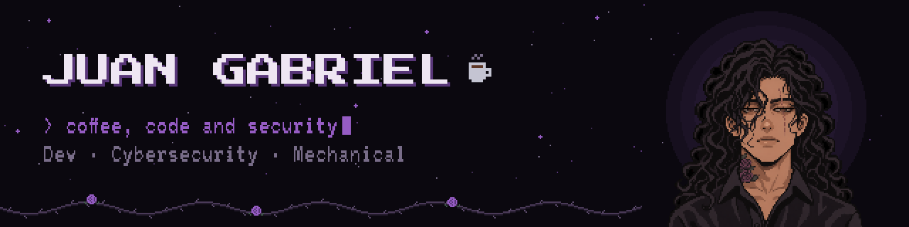

<p align="center">
  
</p>

<p align="center">
  <a href="https://www.youtube.com/@juangfaraujo"></a>
  <a href="https://www.instagram.com/SEU_USUARIO"></a>
  <a href="https://www.tiktok.com/@SEU_USUARIO"></a>
  <a href="https://www.linkedin.com/in/SEU_USUARIO"></a>
</p>

---

### ☕ `whoami`

```bash
$ whoami
> Juan Gabriel — developer, cybersecurity student and mechanical tinkerer

$ cat focus.txt
> Building things in code, learning how to break (and protect) them,
> and sharing the journey along the way.
```

- 🔐 Currently studying: **[ex.: pentest, redes, CTFs]**
- 💻 Working on: **[seu projeto atual]**
- ⚙️ Mechanical side: **[ex.: CAD, manutenção, automação]**
- 🎥 Sharing what I learn on [YouTube](https://www.youtube.com/@juangfaraujo)

---

### 🛠️ Toolbox

**Code**


**Security**


**Mechanical**


---

### 📊 Stats

<p align="center">
  
  
</p>

---

<p align="center">
  <i>☕ fueled by coffee · 🔐 driven by curiosity</i>
</p>
